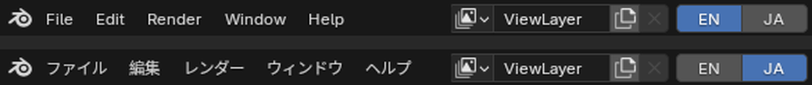
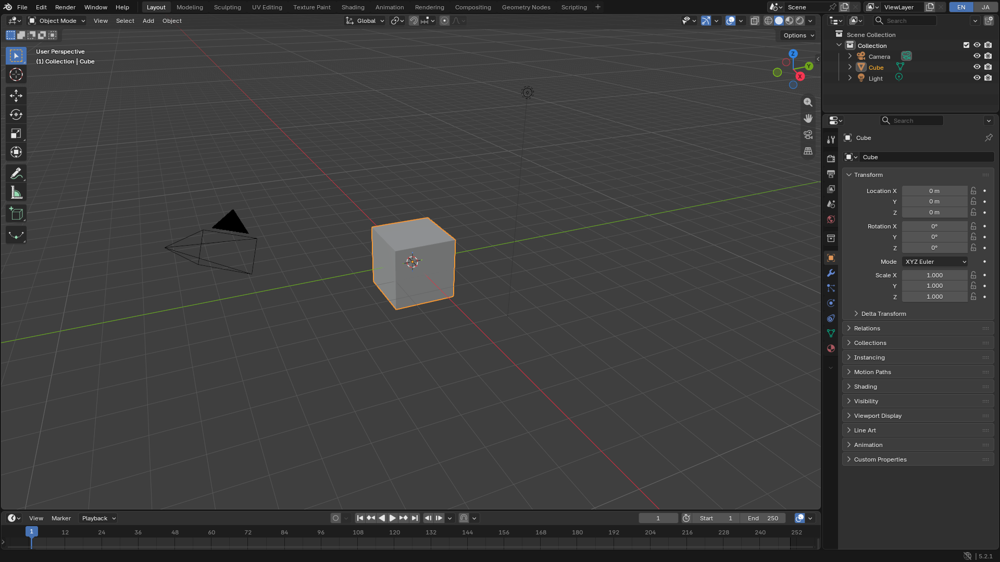
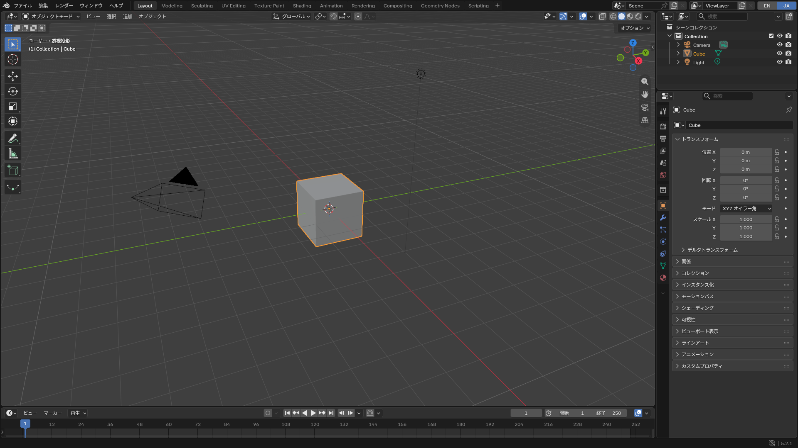
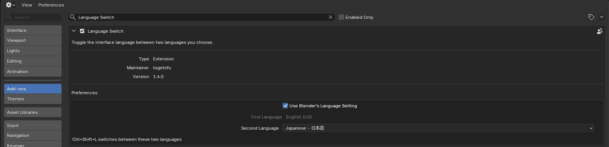
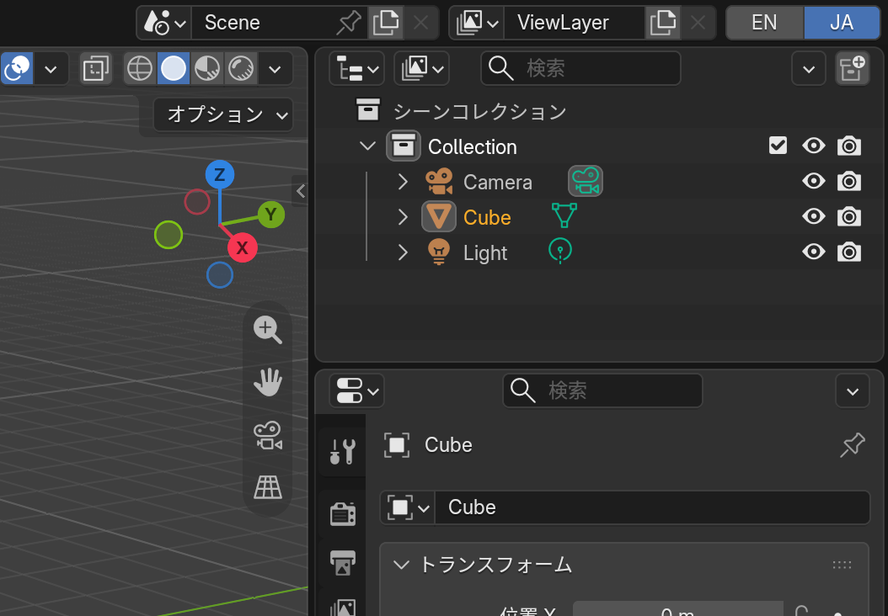

# Language Switch

A free Blender add-on that switches the interface language between two languages in one click.

[日本語の説明は下にあります](#日本語)

## Features

- Two buttons at the right end of the Top Bar (**EN** / **JA** by default; in the Info header before Blender 2.80).
- **Ctrl+Shift+L** toggles between the two languages.
- The first language follows the language set in Blender (Preferences > Interface > Language), so you only choose the language to switch to. Both can also be chosen by hand.
- Switching to a translated language also turns on the translation of the interface, tooltips and reports, so the switch is visible right away.
- The language is a normal Blender preference, so it is saved with your preferences.

| English | Japanese |
|---|---|
|  |  |

## Install

Download `language_switch-<version>.zip` from [Releases](../../releases) (do not unpack it). The same zip works with every supported Blender version.

- **Blender 4.2 or later**: Edit > Preferences > Get Extensions > the menu at the top right > **Install from Disk...** (it is installed as an extension).
- **Blender 2.80 to 4.1**: Edit > Preferences > Add-ons > **Install...**, then enable **Language Switch**.
- **Blender 2.59 to 2.79**: File > User Preferences > Add-ons > **Install Add-on from File...** (Install Add-On... in 2.5x), then enable **Language Switch**.

Do not download "Source code" from the release page to install: it is the repository, not the add-on.

## Settings

Edit > Preferences > Add-ons > **Language Switch**

- **Use Blender's Language Setting** (on by default): the first button is the language set in Preferences > Interface > Language (shown greyed out). Change it there as usual, for example to French, and the buttons become **FR** / **JA**. The add-on remembers it while the second language is shown, also across restarts, and "Automatic" comes back as "Automatic".
- **First Language**: the first button, when the option above is off (English by default).
- **Second Language**: the second button (Japanese by default).
- **Translate Workspace Tabs** (off by default): the tabs at the top (Layout, Modeling...) are names saved in the file, so Blender does not change them when the language changes. When this is on, the standard tabs are renamed to the new language too. Tabs you renamed yourself are left alone. The file then counts as changed, and it is saved with the names of the language shown at that time.

Pressing Ctrl+Shift+L while another language is shown goes back to the first language.

Before Blender 2.80 the settings are simpler: Blender 2.67 to 2.79 have **First Language** and **Second Language** only, and Blender 2.59 to 2.66 have no add-on settings, so the buttons are English and Japanese.

## Compatibility

Requires Blender 2.59 or later. On older versions it refuses to be enabled ("Language Switch needs Blender 2.59 or later").

Blender 2.80 changed the interface a lot, so the zip contains two versions of the add-on, and the one for your Blender is used automatically.

Notes by version:

- **Blender 2.59 to 2.79**: the buttons are in the Info header, after the scene statistics. In a narrow window they can be pushed off the right end; widen the window, or scroll the header with Ctrl+mouse wheel. These versions cannot show a button as pressed, so the buttons do not show which language is active.
- **Blender 2.5x**: the Linux builds of Blender 2.5x have no translation files, so the interface stays in English even when Japanese is chosen (the same happens when you change the language in Blender's own settings).
- **Blender 2.80 to 2.92**: workspace tabs are not renamed, because these versions have no translations of the tab names.
- **Blender 2.80 to 3.6**: reports (the messages in the status bar) are not translated, because these versions cannot translate reports.
- **Blender 2.59 to 4.1**: installed as a legacy add-on (extensions start with Blender 4.2).

Tested with:

- Blender 2.59, 2.79b, 2.80, 2.83.20 LTS, 3.5.1, 4.2.23 LTS, 5.2.0 LTS and 5.2.1 LTS on Linux
- Blender 2.93.18 LTS, 3.6.23 LTS and 4.5.15 LTS on Linux (version 1.6.0)
- Blender 5.3 Alpha on Linux
- Blender 5.2.3 LTS for Windows, run under Wine on Linux (not yet tested on a real Windows PC)

The add-on is pure Python and has no platform-specific code.

## License

GPL-2.0-or-later. See [LICENSE](LICENSE).

---

## 日本語

Blender のインターフェースの言語を、2 つの言語の間でワンクリックで切り替える無料のアドオンです。

### できること

- 上の帯の右端に 2 つのボタン(既定は **EN** / **JA**)が出ます(Blender 2.80 より前は Info の帯)。
- **Ctrl+Shift+L** で 2 つの言語を切り替えます。
- 元の言語は Blender の言語の設定(設定 > インターフェース > 言語)に自動で合うので、選ぶのは変えたい言語だけです。両方を自分で選ぶこともできます。
- 翻訳のある言語へ切り替えると、インターフェース・ツールチップ・レポートの翻訳も一緒に ON になります。
- 言語は Blender の普通の設定なので、他の設定と一緒に保存されます。

### 入れ方

[Releases](../../releases) から `language_switch-<版>.zip` を落とします(展開はしません)。対応するどの版の Blender でも、同じ zip を使います。

- **Blender 4.2 以降**: 編集 > プリファレンス > エクステンションを入手 > 右上のメニュー > **ディスクからインストール...**(拡張機能として入ります)
- **Blender 2.80〜4.1**: 編集 > プリファレンス > アドオン > **インストール...** の後、**Language Switch** を有効にします。
- **Blender 2.59〜2.79**: ファイル > ユーザー設定 > アドオン > **ファイルからアドオンをインストール...**(2.5x では Install Add-On...)の後、**Language Switch** を有効にします。

リリースのページの「Source code」は、リポジトリの中身でアドオンではありません。入れる時は使わないでください。

### 設定

編集 > プリファレンス > アドオン > **Language Switch**

- **Use Blender's Language Setting**(既定は ON): 1 つ目のボタンは「設定 > インターフェース > 言語」で選んだ言語になります(灰色で表示)。そこでいつもどおり、例えばフランス語に変えると、ボタンは **FR** / **JA** になります。第 2 言語の表示中もその言語を覚えていて、再起動しても戻れます。「自動」は「自動」のまま戻ります。
- **First Language**: 上のチェックを外した時の、1 つ目のボタンの言語(既定は英語)。
- **Second Language**: 2 つ目のボタンの言語(既定は日本語)。
- **Translate Workspace Tabs**(既定は OFF): 上のタブ(Layout・Modeling など)はファイルに保存される名前なので、Blender は言語を変えても付け替えません。ON にすると、標準のタブも新しい言語の名前に付け替えます。自分で名前を変えたタブは触りません。付け替えるとファイルは「変更あり」になり、保存すると、その時の言語のタブ名で残ります。

どちらでもない言語を表示している時に Ctrl+Shift+L を押すと、1 つ目の言語に戻ります。

Blender 2.80 より前は設定が少なくなります。2.67〜2.79 は **First Language** と **Second Language** だけです。2.59〜2.66 にはアドオンの設定の仕組みが無いので、ボタンは英語と日本語です。

### 対応する版

Blender 2.59 以降で動きます。それより古い版では有効になりません(「Language Switch needs Blender 2.59 or later」と出ます)。

Blender 2.80 で画面が大きく変わったので、zip には 2 つの版のアドオンが入っていて、使っている Blender に合う方が自動で使われます。

版ごとの注意:

- **Blender 2.59〜2.79**: ボタンは Info の帯の、シーンの統計の後ろに出ます。窓が狭いと右にはみ出すので、窓を広げるか、Ctrl+ホイールで帯を動かしてください。この版ではボタンを押した見た目にできないので、今どちらの言語かはボタンでは分かりません。
- **Blender 2.5x**: Linux 版の 2.5x には翻訳のファイルが入っていないので、日本語を選んでも表示は英語のままです(Blender 自身の設定で言語を変えても同じです)。
- **Blender 2.80〜2.92**: この版にはタブ名の訳が無いので、タブは付け替わりません。
- **Blender 2.80〜3.6**: この版の Blender にはレポートを翻訳する機能が無いので、レポート(画面下に出るお知らせ)は翻訳されません。
- **Blender 2.59〜4.1**: 従来のアドオンとして入ります(拡張機能は Blender 4.2 からです)。

試した版:

- Linux の Blender 2.59・2.79b・2.80・2.83.20 LTS・3.5.1・4.2.23 LTS・5.2.0 LTS・5.2.1 LTS
- Linux の Blender 2.93.18 LTS・3.6.23 LTS・4.5.15 LTS(1.6.0 で)
- Linux の Blender 5.3 Alpha
- Windows 版 Blender 5.2.3 LTS(Linux の Wine の上で。本物の Windows ではまだ試していません)

Python だけで書かれていて、OS ごとに違う部品はありません。

### ライセンス

GPL-2.0-or-later です。[LICENSE](LICENSE) を見てください。
